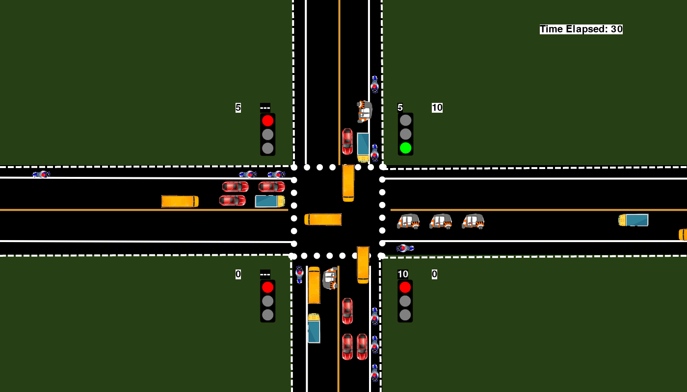

# Adaptive Traffic Simulation

A 4-way traffic intersection simulator built with **Python + Pygame** that dynamically calculates green-signal duration from real-time lane density, and gives automatic priority to ambulances.



## What this simulation does

- Renders a 4-way intersection (`right`, `down`, `left`, `up`) with 3 lanes per approach.
- Spawns cars, buses, trucks, rickshaws, bikes, and ambulances at randomized intervals and directions, including vehicles that turn at the intersection.
- Runs a red → green → yellow signal cycle across all four approaches, with realistic vehicle queuing, stopping distances, and gap-keeping behind the vehicle ahead.
- **Adaptive green time:** while one signal is red, the simulator counts the number and type of vehicles waiting in the *next* lane to go green and computes the required green duration:

  ```

  greenTime = ceil( (cars*2.25 + rickshaws*2.25 + buses*2.5 + trucks*2.5 + bikes*1.5 + ambulances*1) / (lanes + 1) )
  ```

  clamped between a 10s minimum and 60s maximum — busier lanes automatically get more green time, quieter lanes get less.
- **Ambulance priority hook:** ambulances are tagged (`is_ambulance`) and logged as soon as they cross the stop line, giving the system a real-time signal it can use to interrupt the normal cycle for emergency vehicles.
- Tracks and displays, per lane, the live count of vehicles that have crossed the intersection, plus a running "Time Elapsed" counter.
- At the end of the configured `simTime`, prints a summary to the console: total vehicles per lane, total vehicles passed, total time, and vehicles-per-unit-time throughput.

## Project structure

```
Traffic_Simulation/
├── simulation.py        # Full simulation source (unmodified from the original project)
├── images/               # Vehicle, signal, and background sprites used by the simulator
│   ├── base.png
│   ├── signals/          # red.png, yellow.png, green.png
│   ├── right/ down/ left/ up/   # per-direction vehicle sprites (car, bus, truck, rickshaw, bike, ambulance)
├── output/                # Captured from an actual run of the simulation
│   ├── traffic_simulation.mp4   # ~62s video of the full run
│   ├── screenshot_t5.png
│   ├── screenshot_t15.png
│   ├── screenshot_t30.png
│   ├── screenshot_t45.png
│   └── screenshot_t59.png
├── requirements.txt
└── README.md
```

## Requirements

- **Python 3.9 – 3.13** (Python 3.12 recommended). **Python 3.14 is not yet supported** — pygame 2.6.1 has no prebuilt wheel for it, so `pip install pygame` will try to compile from source and fail unless you have Microsoft Visual C++ Build Tools installed. Use 3.12 to avoid this entirely.
- `pygame` (installed via `requirements.txt` below)

### Checking / installing the right Python version

1. Check what's currently active:
   ```
   python --version
   ```
2. If it reports 3.14.x, download the **Windows installer (64-bit)** for Python 3.12 from https://www.python.org/downloads/release/python-3120/ (table further down the page — not the "Python install manager" button at the top).
3. Run the installer and **check "Add python.exe to PATH"** before clicking Install.
4. See every Python version installed on your machine:
   ```
   py -0
   ```
5. If using VS Code: press **Ctrl+Shift+P** → `Python: Select Interpreter` → choose the **3.12.x** entry (or "Enter interpreter path" and browse to `...\Python312\python.exe` if it's not listed). Then open a **new** terminal so it picks up the change.

## How to run it

1. Install the dependency:
   ```
   pip install -r requirements.txt
   ```
   (equivalent to `pip install pygame`). With Python 3.12 active, this installs a prebuilt wheel in seconds — no compiler needed.
2. Run from inside this folder (the script loads images with relative paths):
   ```
   python simulation.py
   ```
3. A window titled **"SIMULATION"** opens showing the intersection. Vehicles spawn automatically, signals cycle automatically — there's nothing to click. Close the window or press `Ctrl+C` to stop early, or let it run to the configured `simTime` (in seconds) for it to auto-close and print the summary stats to the console.

### Troubleshooting

| Symptom | Cause | Fix |
|---|---|---|
| `ModuleNotFoundError: No module named 'pygame'` | pygame isn't installed for the interpreter you're running | Run `pip install pygame` in the terminal (not typed into the code file) |
| `pip install pygame` tries to build from source and fails with `ModuleNotFoundError: No module named 'distutils.msvccompiler'` | You're on Python 3.14 (or another version pygame has no wheel for) and pip is falling back to a source build, which needs a C++ compiler you don't have | Switch to Python 3.12 (see above) and reinstall |
| `SyntaxError: invalid syntax` on a line like `pip install pygame --pre` inside `simulation.py` | A terminal command got typed into the code editor by mistake | Delete that line from the file; run install commands in the **Terminal** panel, not the editor |
| Status bar still shows the old Python version after installing a new one | VS Code interpreter wasn't switched, or the terminal is stale | `Ctrl+Shift+P` → `Python: Select Interpreter` → pick the new version → open a **new** terminal |

## Verified output

`output/traffic_simulation.mp4` is a ~62-second screen-capture video of a real run of this exact `simulation.py` (rendered headlessly via `xvfb-run`, frames saved at 20fps and stitched with `ffmpeg`; `simTime` was temporarily shortened just to keep the capture short — the simulation logic itself was not changed). Play it to see vehicles spawning, queuing, turning, and the adaptive signal timing switching live.

The screenshots in `output/` are individual frames pulled from that same run. They show:

- **t=5s** — first vehicles entering the intersection, initial green light active.
- **t=30s** — heavy queuing on the `down` approach with a longer computed green time (adaptive to density), an ambulance and rickshaw mixed into traffic.
- **t=59s** — multiple lanes queued, an ambulance visibly present in the `down` lane, and per-lane crossed-vehicle counters updating live in the corner of each signal.

This confirms the rendering, vehicle spawning/movement/turning, adaptive signal timing, and lane-counting all work end-to-end as implemented.

## Known limitation

The emergency-vehicle response currently only **logs** ambulance crossings to the console (`"<direction> crossed"`) rather than actively overriding the signal cycle — the hook (`is_ambulance` flag) is in place, but the override logic (suspend current green, flash yellow elsewhere, force green for the ambulance's lane) is not yet wired into `repeat()`. Extending `setTime()`/`repeat()` to check `is_ambulance` before a signal turns red is the natural next step if full emergency pre-emption is needed.
